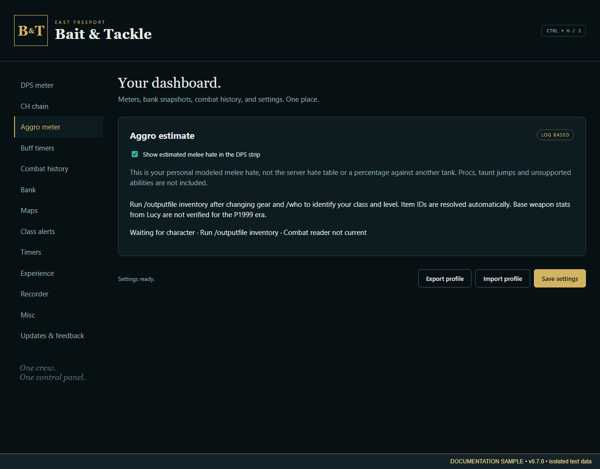

# Aggro estimates

[Wiki home](README.md) · [Installation](Installation.md) · [Quick reference](Quick-reference.md) · [Troubleshooting](Troubleshooting.md)

This displays your modeled melee hate, not a server hate list or your percentage against another tank. Run `/outputfile inventory` after changing weapons and `/who` to supply class and level. Item IDs are resolved to weapon data when available. External item data may not match the P1999 era. Procs, taunt jumps, and unsupported abilities are excluded. Never use this display as a guarantee that a tank has established aggro.

## Setup

1. Run `/outputfile inventory` with your intended weapons equipped.
2. Run `/who`.
3. Inspect character, class/level, export freshness, resolved weapon stats and lookup errors in Aggro meter.
4. Enable its display in the DPS strip.

A stale export can mean old weapons. A lookup failure is not a zero-damage weapon. Wrong class/level can alter modeled bonuses.

## Confidence boundary

This is partial **personal estimated melee hate**. It cannot rank you against another tank, display a server hate list, or model every proc, taunt and ability. A precise-looking number does not make the model server-authoritative. Use raid calls and actual mob behavior when tanking.

*Real v0.7.0 dashboard rendered with isolated sample data. This screenshot documents controls and appearance, not successful live gameplay.*

---
[All pages](README.md) · [Report a bug](https://github.com/Trakstx/bait-and-tackle-ui/issues/new?template=bug.yml)
