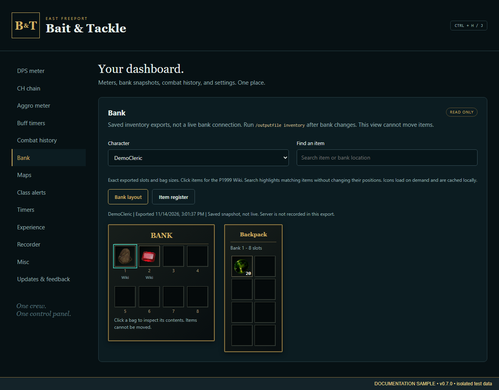

# Bank snapshots and item register

[Wiki home](README.md) · [Installation](Installation.md) · [Quick reference](Quick-reference.md) · [Troubleshooting](Troubleshooting.md)

Run `/outputfile inventory` to refresh the snapshot. The bank view is read-only and cannot move items. Click an item to open its P1999 wiki lookup. Snapshots are not a live bank connection. Inspect the character and export time before trusting the display; the export does not reliably identify the server.

## Refresh and browse

1. Run `/outputfile inventory` on the intended character.
2. Open Bank and select the character.
3. Check the export timestamp.
4. Choose Bank layout or Item register.
5. Click a saved bag to inspect its exported slots.
6. Search highlights matches without changing their positions.
7. Use an item/wiki link for a P1999 wiki lookup.

This cannot withdraw, equip, combine or move anything. A dashboard bag is a snapshot view, not a live native container. Repeat the export after banking.

The export does not reliably identify server. Matching character names on different servers can be ambiguous. Verify character and freshness before trusting contents.

*Real v0.7.0 dashboard rendered with isolated sample data. This screenshot documents controls and appearance, not successful live gameplay.*

---
[All pages](README.md) · [Report a bug](https://github.com/Trakstx/bait-and-tackle-ui/issues/new?template=bug.yml)
