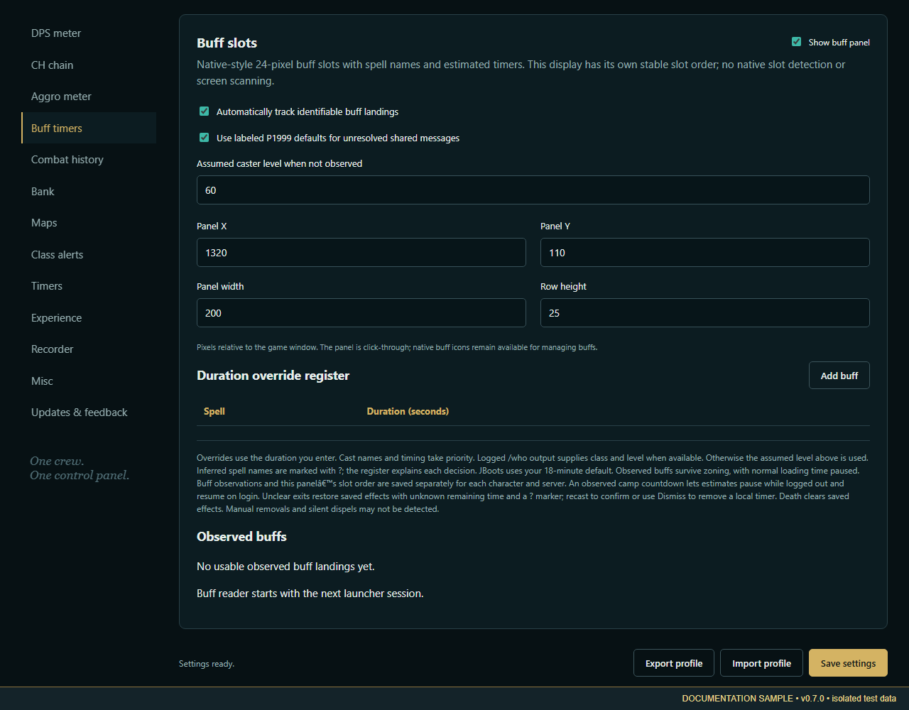

# Buff icons and duration estimates

[Wiki home](README.md) · [Installation](Installation.md) · [Quick reference](Quick-reference.md) · [Troubleshooting](Troubleshooting.md)

The helper has its own icon-and-timer panel. It reads cast names, landing messages, and wear-off messages. Its stable display order is separate from EQ's native buff slots. It does not determine native slots through screen scanning.

Shared landing text is ambiguous. Configure duration overrides and review inferred entries marked with `?`. Unknown duration is preferable to false precision. Native icons remain the place to click effects off. Silent dispels and manual removal may be missed. Zoning preserves observations and pauses normal loading time. Observed camp countdowns allow logout timing to pause; unclear exits can restore effects with unknown remaining time. Death clears saved observations. JBoots has the configured 18-minute default; it is an estimate unless confirmed by observed events.

## Setup

1. Enable Show buff panel and automatic tracking if wanted.
2. Position it beside native buffs using X/Y, width and row height.
3. Set the assumed caster level only when actual level is not observed.
4. Add duration overrides for spells that need them.
5. Recast a known effect and review its observed entry.

| State | Meaning | Action |
|---|---|---|
| Identified observation | Recognized messages supported the entry | Check duration assumptions |
| `?` or inferred name | Shared text or unclear restoration | Review register or recast |
| Unknown duration | Effect may exist; timing unconfirmed | Recast to establish timing |
| Missing helper entry | No recognized observation | Keep native icons accessible |
| Entry after silent removal | Helper missed removal | Dismiss local observation |

Helper row numbers do not claim native slot identity. Dismiss removes a local timer, not the game effect.

## Zoning and camping

Normal observed zoning preserves observations. An observed camp countdown can pause duration while logged out. Crashes, disconnects, missing messages and silent dispels make restoration uncertain. Recast after uncertainty rather than assuming a restored timer proves the buff exists.

*Real v0.7.0 dashboard rendered with isolated sample data. This screenshot documents controls and appearance, not successful live gameplay.*

---
[All pages](README.md) · [Report a bug](https://github.com/Trakstx/bait-and-tackle-ui/issues/new?template=bug.yml)
