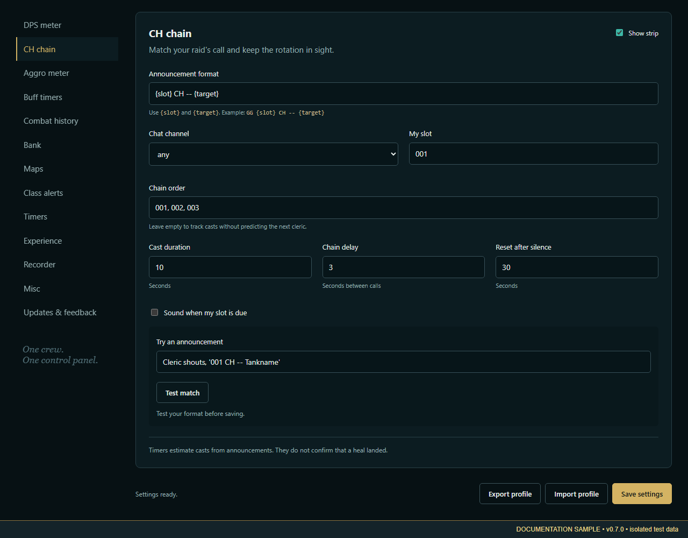

# Complete Heal chain

[Wiki home](README.md) · [Installation](Installation.md) · [Quick reference](Quick-reference.md) · [Troubleshooting](Troubleshooting.md)

Configure announcement format, channel, ordered roster, your slot, cast length, cadence, and reset timeout. Test a sample announcement before a raid. A format such as `{slot} CH -- {target}` must match the actual raid call, including its expected structure. The strip estimates timing from announcements; a call is not proof that a heal landed. Resists, fizzles, interrupts, missed calls, and changes in raid convention can invalidate estimates. Agree on one announcement format with the chain leader.

## Working example

| Setting | Value |
|---|---|
| Format | `{slot} CH -- {target}` |
| Channel | `shout` for shouted calls; `any` while testing |
| My slot | `001` |
| Chain order | `001, 002, 003` |
| Cast duration | `10` seconds |
| Chain delay | `3` seconds between calls |
| Reset after silence | `30` seconds |

**Chain order contains slot identifiers, not character names.** Supported slots are 1–3 digits, repeated three-letter identifiers such as `AAA`, and `RAMP1` through `RAMP999`. Numeric slots normalize to three digits; duplicates are rejected.

The format needs `{slot}` and exactly one `{target}`. Other placeholders are unsupported.

## Test

1. Enter settings above.
2. Test `Cleric shouts, '001 CH -- Tankname'`.
3. Confirm the tester recognizes slot 001 and Tankname.
4. Save settings and observe a real raid call in the selected log.

The tester validates matching, not log filters or raid timing. Leave chain order empty to track observed calls without predicting the next cleric. Enable sound only after confirming your slot.

A correctly parsed announcement can still be followed by a fizzle, interrupt or target problem. It is not landed-heal confirmation.

*Real v0.7.0 dashboard rendered with isolated sample data. This screenshot documents controls and appearance, not successful live gameplay.*

---
[All pages](README.md) · [Report a bug](https://github.com/Trakstx/bait-and-tackle-ui/issues/new?template=bug.yml)
