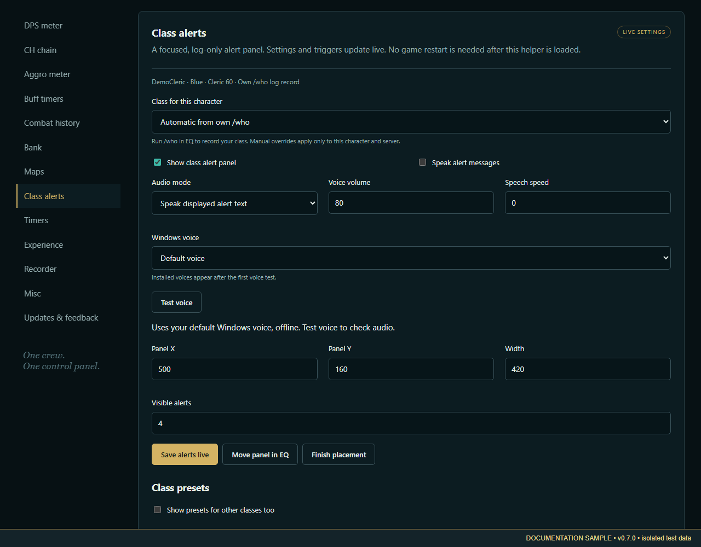

# Class-aware alerts and custom triggers

[Wiki home](README.md) · [Installation](Installation.md) · [Quick reference](Quick-reference.md) · [Troubleshooting](Troubleshooting.md)

Class alerts use observed identity or a manual class override. Enable only the presets you want. Custom rules support literal text and wildcard matching, class restrictions, severity, short messages, estimated countdowns, and Windows speech. They do not execute game commands. Test each rule with a representative message. Audio uses the selected installed Windows voice. Avoid putting credentials into trigger text or shared profiles.

## Class awareness

Run `/who`, inspect the detected character/class, and use a per-character override if needed. Review eligible presets before enabling audio. Examples include enrage, gating, invis fading, death, fizzles, resists, charm breaks, failed feign death, interrupted songs and failed hide. They still require matching log lines.

## Custom rule example

| Field | Example |
|---|---|
| Name | Casting reminder |
| Match mode | Exact |
| Match text | `Your spell fizzles!` |
| Alert message | `CAST FAILED — {character}` |
| Severity | Warning |
| Countdown | 0 for a short banner |
| Classes | Cleric |

Wildcards use `*` and `?`, not executable code. Message substitutions include `{character}`, `{class}` and `{line}`. Keep rules narrow and apply cooldowns where repeated lines would be distracting.

## Audio test

Choose an installed Windows voice, speed and volume, then use Test voice. Speech is local. A successful voice test confirms output, not the rule's match. Test the rule separately against representative text.

*Real v0.7.0 dashboard rendered with isolated sample data. This screenshot documents controls and appearance, not successful live gameplay.*

---
[All pages](README.md) · [Report a bug](https://github.com/Trakstx/bait-and-tackle-ui/issues/new?template=bug.yml)
