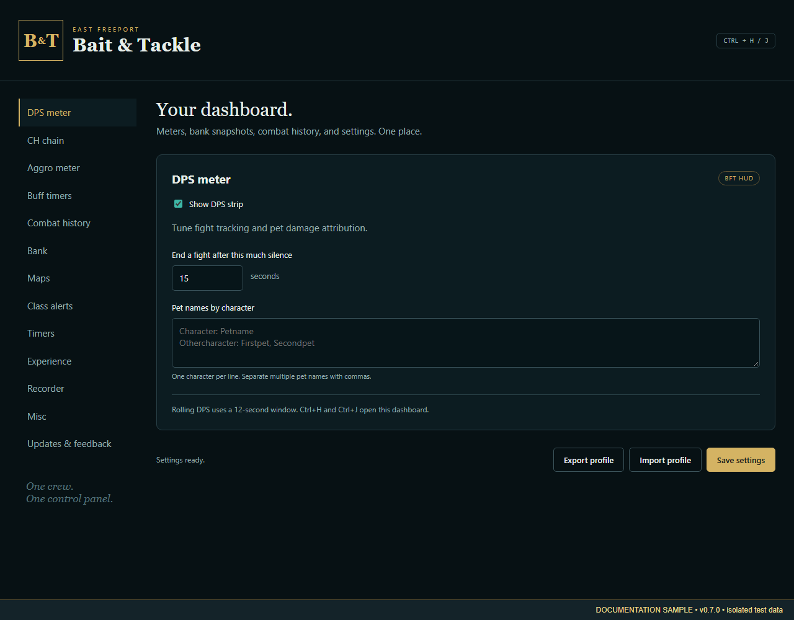

# DPS meter and combat history

[Wiki home](README.md) · [Installation](Installation.md) · [Quick reference](Quick-reference.md) · [Troubleshooting](Troubleshooting.md)

The strip shows rolling and fight-based damage statistics from messages visible in the selected character's log. The rolling window is 12 seconds. Configure the fight-end silence timeout and pet names in DPS settings. Pet attribution requires recognizable messages and configured pet names. Missing or filtered messages produce incomplete totals. Generic magic damage cannot always be assigned to a caster. This is a parser, not server combat telemetry.

The reader follows active log activity and character changes. If it follows the wrong character, ensure the current character is logging and producing new lines. Avoid relying on old log modification times alone when diagnosing character identity.

## Setup

1. Open DPS meter and enable Show DPS strip.
2. Choose the silence timeout. Short values can split encounters; long values can merge nearby fights.
3. Enter pets as `Character: Petname`, with commas for multiple names.
4. Save and observe fresh logged combat.

| Measure | Meaning | Why another parser can differ |
|---|---|---|
| Rolling DPS | Recent 12-second damage window | Different window or attribution |
| Fight DPS | Assigned damage / tracked duration | Different fight boundaries |
| Damage | Observed assigned damage | Range, filters and generic magic |
| Biggest hit | Largest recognized hit | Different observed messages |
| Hit rate | Recognized attacks and misses | Missing/unsupported miss messages |
| Taken | Recognized incoming damage | Unusual messages and absorbs |

## Verify a surprising result

Compare the same character, time range, pet policy and fight boundary. Use a short sanitized log excerpt. Do not compare rolling DPS directly with fight DPS.

History is read-only. Empty history can mean no completed fight has been recorded yet. It does not alone prove the dashboard failed.

*Real v0.7.0 dashboard rendered with isolated sample data. This screenshot documents controls and appearance, not successful live gameplay.*

---
[All pages](README.md) · [Report a bug](https://github.com/Trakstx/bait-and-tackle-ui/issues/new?template=bug.yml)
