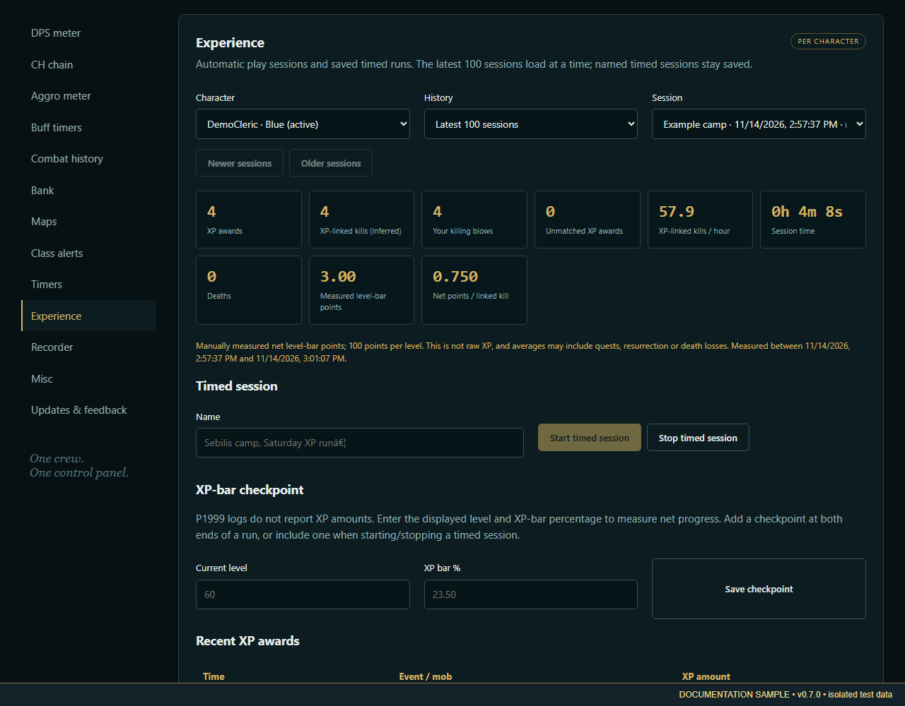

# Experience sessions and checkpoints

[Wiki home](README.md) · [Installation](Installation.md) · [Quick reference](Quick-reference.md) · [Troubleshooting](Troubleshooting.md)

Automatic sessions and manually named sessions organize observed activity. Log messages can identify kills and experience events, but do not always expose an exact XP percentage. Use checkpoints when precise progress is needed. Do not treat an inferred event count as a measured percentage. The interface limits loaded session history rather than presenting all history at once.

## Record a specific camp

1. Verify the selected character.
2. Start a named manual session, such as Evening camp.
3. Supply accurate level/percentage checkpoints when needed.
4. Let recognized kills and XP events accumulate.
5. Add an ending checkpoint and stop the named session.
6. Review events and session totals.

Automatic and manual sessions can overlap. Do not add overlapping totals as independent experience earned.

Kill and XP messages are observations, not the exact server award. Grouping, death, resurrection, level boundaries and missing messages affect interpretation. Checkpoint-based percentage changes are only as reliable as the checkpoints. The screenshot uses synthetic events and progress.

*Real v0.7.0 dashboard rendered with isolated sample data. This screenshot documents controls and appearance, not successful live gameplay.*

---
[All pages](README.md) · [Report a bug](https://github.com/Trakstx/bait-and-tackle-ui/issues/new?template=bug.yml)
