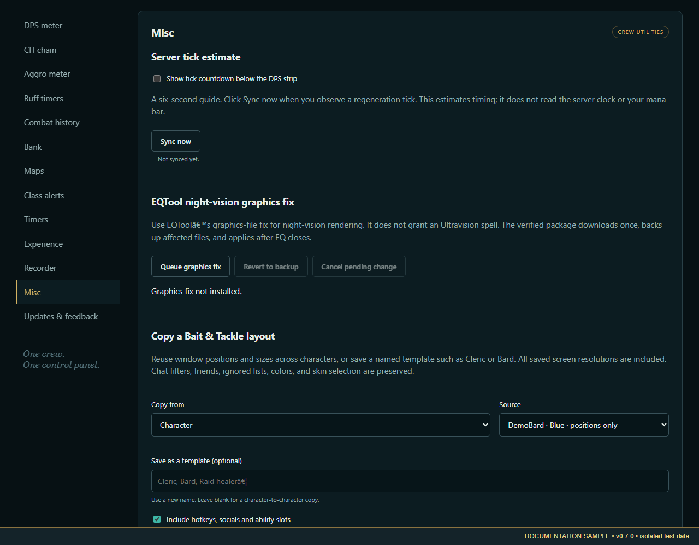

# Layouts, hotkeys and native bags

[Wiki home](README.md) · [Installation](Installation.md) · [Quick reference](Quick-reference.md) · [Troubleshooting](Troubleshooting.md)

Server tick display is an estimate synchronized by the helper. Layout copying transfers saved window positions and sizes between characters or named templates. Optional hotkey copying also replaces saved socials and ability assignments. Different classes can have incompatible abilities or spell-gem references. Preview first. Copies are queued until EQ closes normally so the client cannot overwrite the result. Backups are created before target files change.

The graphics visibility fix modifies graphics files and is queued until EQ closes. It does not grant an Ultravision spell. Use its backup/revert control if needed.

## Copy a layout

1. Open Misc and choose a source character or saved template.
2. Select targets or a new template name.
3. Decide whether to include hotkeys, socials and ability assignments.
4. Preview the operation and read what it will change.
5. Queue it, then close EQ normally.
6. After application, inspect each target before relying on class-specific hotkeys.

Class-specific ability IDs and spell gems can mean different things on another class. Layout copying handles saved positions/resolutions, not class compatibility.

## Native versus helper windows

The skin supplies native XML windows; the external helper supplies extra strips/panels. Some melee classes do not expose spell gems. Core information must not depend on a caster-only window.

Current bags use vertical native containers with C/X controls at the top. Native containers can reserve client-controlled space. Moving visible slot art does not remove invisible drag/hit regions. Avoid overlapping window rectangles or forcing access to slots beyond a bag's actual capacity.

The tick display is an estimate. The optional graphics visibility fix changes files after EQ closes and can revert its backup; it does not grant an Ultravision spell.

*Real v0.7.0 dashboard rendered with isolated sample data. This screenshot documents controls and appearance, not successful live gameplay.*

---
[All pages](README.md) · [Report a bug](https://github.com/Trakstx/bait-and-tackle-ui/issues/new?template=bug.yml)
