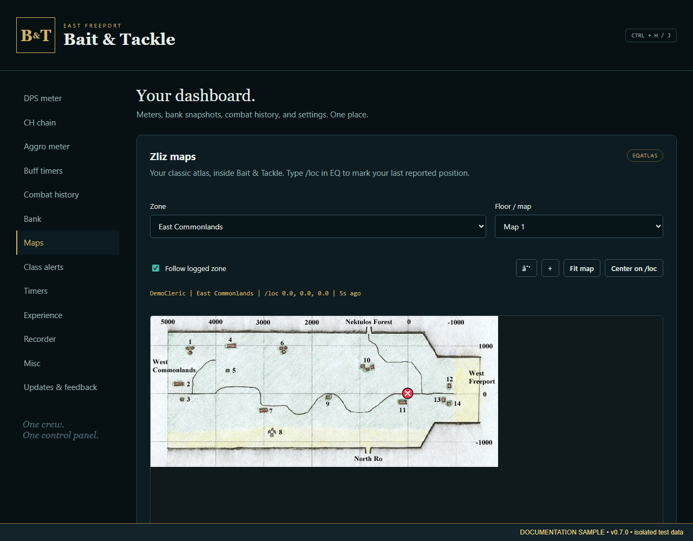

# Maps and last reported location

[Wiki home](README.md) · [Installation](Installation.md) · [Quick reference](Quick-reference.md) · [Troubleshooting](Troubleshooting.md)

Browse the bundled Zliz/EQAtlas maps. `/loc` updates the last reported position. Successful Sense Heading immediately before `/loc` can supply direction. This is not continuous GPS. Select dungeon floors manually. Zone and character changes clear stale markers.

## Use

1. Choose a zone and floor, or enable Follow logged zone.
2. Enter `/loc` in EQ.
3. Inspect the character, zone, coordinates and age above the map.
4. Use zoom, Fit map and Center on /loc.
5. Select dungeon floors manually.

Travel without another `/loc` leaves the marker behind. A zone-entry message does not reveal your precise position. A successful Sense Heading before `/loc` can add heading; it is not continuous compass telemetry.

Map artwork and calibration come from the bundled ZlizEQMap/EQAtlas library. Preserve their credits. Old artwork and floor calibration may be imperfect. The screenshot shows a synthetic point, not a live player position.

*Real v0.7.0 dashboard rendered with isolated sample data. This screenshot documents controls and appearance, not successful live gameplay.*

---
[All pages](README.md) · [Report a bug](https://github.com/Trakstx/bait-and-tackle-ui/issues/new?template=bug.yml)
