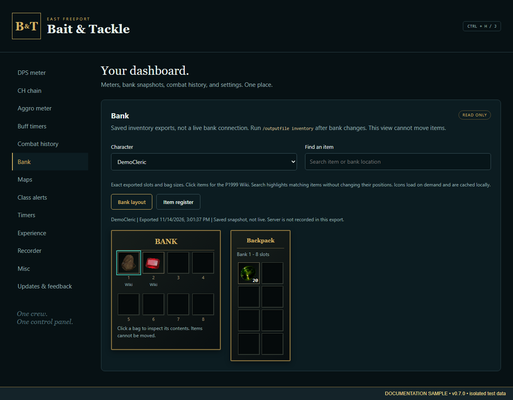

# Bait & Tackle Wiki

**Player documentation for v0.7.0 public preview.** Native EQ skin, companion meters and one local dashboard.

[Download latest release](https://github.com/Trakstx/bait-and-tackle-ui/releases/latest) · [Request a feature](https://github.com/Trakstx/bait-and-tackle-ui/issues/new?template=feature.yml) · [Report a bug](https://github.com/Trakstx/bait-and-tackle-ui/issues/new?template=bug.yml)

*Real dashboard, isolated sample data. Images document appearance and controls, not successful live raid tests.*

## Start here

1. [Install and launch](Installation.md).
2. Enable /log on, load the skin, and press Ctrl+J.
3. Follow the [daily checklist](Quick-reference.md).
4. Review [known limitations](Known-limitations.md) before relying on estimates or the recorder preview.

The base package is approximately 43.5 MB downloaded / 84 MB extracted. Optional OBS, backups, caches and saved incidents are additional.

## Guides

- [Installation and first launch](Installation.md)
- [Commands and daily checklist](Quick-reference.md)
- [DPS meter and combat history](DPS-and-history.md)
- [Complete Heal chain](CH-chain.md)
- [Aggro estimates](Aggro.md)
- [Buff icons and duration estimates](Buffs.md)
- [Bank snapshots and item register](Bank.md)
- [Maps and last reported location](Maps.md)
- [Class-aware alerts and custom triggers](Class-alerts.md)
- [Event and manual timers](Timers.md)
- [Experience sessions and checkpoints](Experience.md)
- [Layouts, hotkeys and native bags](Layouts-and-native-UI.md)
- [Five-minute incident recorder](Recorder.md)
- [Updates, bugs and feature requests](Updates-and-feedback.md)
- [Troubleshooting and recovery](Troubleshooting.md)
- [Privacy, files and cleanup](Privacy-and-files.md)
- [Known limitations and validation status](Known-limitations.md)
- [Frequently asked questions](FAQ.md)
- [Maintainer release and documentation workflow](Maintainers.md)

## About this wiki

Every feature guide explains prerequisites, settings, verification and confidence limits. Read status and freshness in the app. Sample names and formats must be adapted to your character or raid.

This repository-hosted wiki lives in docs/wiki so the GitHub connector can update it without desktop control. It is separate from GitHub's Wiki tab. Navigate with the links on each page or GitHub repository search.

The updater's public download verification passed. The recorder's final single-controller in-game test remains pending. This unofficial community project does not claim staff approval.
