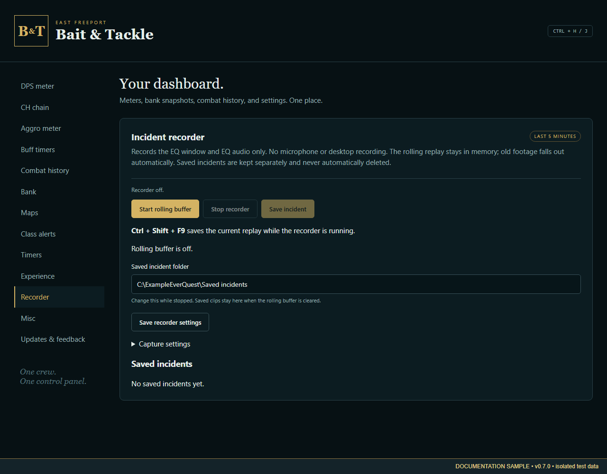

# Five-minute incident recorder

[Wiki home](README.md) · [Installation](Installation.md) · [Quick reference](Quick-reference.md) · [Troubleshooting](Troubleshooting.md)

The optional recorder uses an isolated portable OBS runtime. On first use it downloads the pinned official OBS package, approximately 224 MB. This runtime is separate from a personal OBS installation.

The intended recording profile is native client size, capped at 1920×1200, 15 FPS, approximately 3 Mbps H.264 video and 96 Kbps audio. It captures the EQ client and its process audio, without a microphone or desktop-wide capture source. Hardware encoding is selected when supported; software fallback can use more CPU.

Unsaved footage rolls through a five-minute RAM buffer. The encoded payload is roughly 116 MB for five minutes at this bitrate, with additional OBS/GPU/process overhead. This is not a hard total-memory cap. Old unsaved footage rolls off automatically. Saving an incident writes an MKV and metadata into the chosen folder. **Saved incidents do not automatically expire.** Choose a folder with sufficient space and manage permanent clips yourself.

Start or stop recording from Recorder. Ctrl+Shift+F9 requests a saved incident while the buffer is active. Wait for the saved filename/status before assuming you have evidence. A recent start contains only footage since recording began. A crash or abrupt exit can lose unsaved RAM footage. Closing the owned EQ session stops its helpers and recorder.

**Validation status:** EQ-only video and an AAC audio track were observed in a prototype. The final single-controller profile, five-minute retention, hotkey, and saved-incident lifecycle still require an end-to-end live check. Do not depend on this preview as your only evidence recorder until that check passes on your PC.

## Verify before relying on evidence capture

1. While stopped, choose a writable local incident folder and save settings.
2. Start rolling buffer; allow the first-use OBS download/verification to finish.
3. Wait for Active. Starting is not recording.
4. Play briefly with audible game sound.
5. Save incident or press Ctrl+Shift+F9.
6. Wait for a saved filename.
7. Play the MKV and check both picture and sound.
8. Confirm it remains after stopping the recorder and closing EQ.

A save request alone is not proof of a completed clip. Immediately after start, the replay contains only footage recorded since start.

| Data | Location | Retention |
|---|---|---|
| Unsaved replay | RAM/process buffer | Old footage rolls off; discarded on stop |
| Saved MKV | Your chosen folder | Permanent until you delete it |
| Metadata JSON | Alongside incident | Permanent until you delete it |
| OBS runtime | Separate helper runtime | Additional first-use installation |

Encoded bitrate does not impose a hard cap on total process/GPU memory. Test local resource usage. The final single-controller live retention/hotkey/audio lifecycle test remains pending; use a validated alternative until your local test passes.

*Real v0.7.0 dashboard rendered with isolated sample data. This screenshot documents controls and appearance, not successful live gameplay.*

---
[All pages](README.md) · [Report a bug](https://github.com/Trakstx/bait-and-tackle-ui/issues/new?template=bug.yml)
