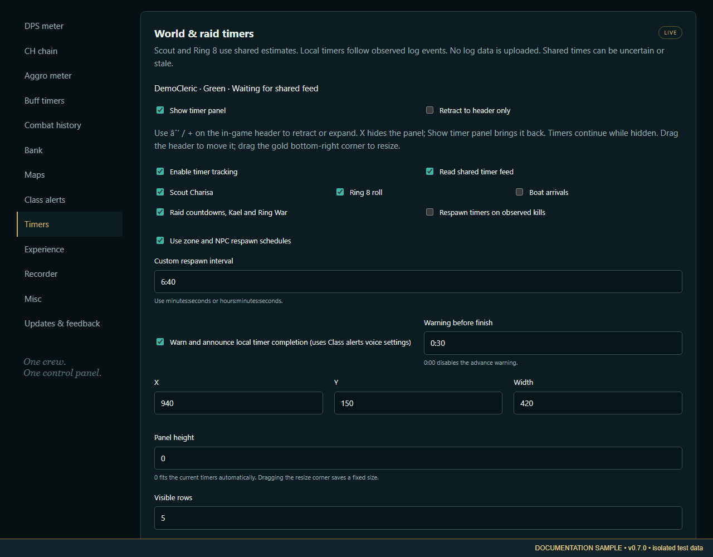

# Event and manual timers

[Wiki home](README.md) · [Installation](Installation.md) · [Quick reference](Quick-reference.md) · [Troubleshooting](Troubleshooting.md)

The panel displays estimated countdowns from supported events, manual timers and optional shared estimates. Its catalog includes EQTool-derived patterns/schedules; preserve bundled MIT attribution and source notes.

## Make a manual timer

1. Open Timers.
2. Enter a name and duration, for example `05:00` or `01:30:00`.
3. Start it and confirm the countdown.
4. Position and resize the panel.
5. Collapse or hide when desired. Hiding does not cancel timers.
6. Remove a timer to cancel the local entry.

Durations accept seconds, mm:ss or hh:mm:ss, bounded from one second to seven days. Minutes/seconds in colon-separated values must remain below 60.

## Categories and sources

Settings include Scout, Ring 8, boats, raid and respawn estimates where supported. Enabling a category does not grant exact server spawn knowledge. Check each timer's event, source, server, duration and freshness.

Shared estimates require network access and server detection. Disable them for local/manual operation. A stale remote estimate is not an authoritative spawn clock. A missing event can leave the panel empty; a mathematically correct countdown can still start from a wrong observation.

*Real v0.7.0 dashboard rendered with isolated sample data. This screenshot documents controls and appearance, not successful live gameplay.*

---
[All pages](README.md) · [Report a bug](https://github.com/Trakstx/bait-and-tackle-ui/issues/new?template=bug.yml)
