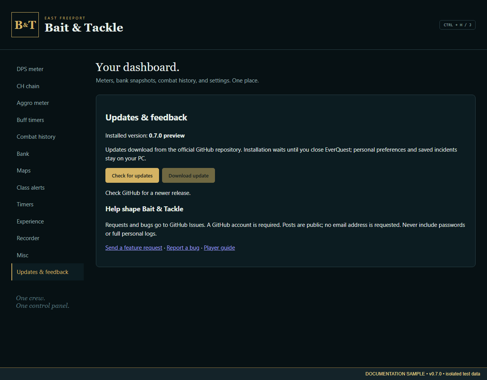

# Updates, bugs and feature requests

[Wiki home](README.md) · [Installation](Installation.md) · [Quick reference](Quick-reference.md) · [Troubleshooting](Troubleshooting.md)

## Update

1. Open Updates & feedback in Ctrl+J.
2. Check for updates.
3. If a compatible newer published release appears, download it.
4. Wait for checksum verification and Verified update ready.
5. Close EQ normally.
6. Open the displayed staging folder and run the extracted installer.
7. Restart with Play Bait and Tackle and confirm the version.

Updates stage under `%LOCALAPPDATA%\BaitAndTackle\updates\<version>`. They do not silently replace loaded components. Personal settings remain in LocalAppData; permanent incidents remain in the selected folder.

The updater expects a numeric vX.Y.Z tag, `Bait-and-Tackle-vX.Y.Z.zip` and `SHA256SUMS.txt`. It checks GitHub's latest non-prerelease release only when requested. Prereleases are not currently selected by this channel.

## Trust and failure handling

Expected asset origins, download size, SHA-256 and extraction paths are validated. A checksum detects mismatch/corruption, not independent authenticity if the publishing account is compromised. Never bypass mismatch errors. Network failures should leave installation untouched.

## Feedback without email

[Request a feature](https://github.com/Trakstx/bait-and-tackle-ui/issues/new?template=feature.yml) with your task, the gap in current behavior, and an example. Search existing issues first.

[Report a bug](https://github.com/Trakstx/bait-and-tackle-ui/issues/new?template=bug.yml) with version, Windows version, resolution, expected/actual behavior and reproduction steps.

GitHub accounts are required. Posts, usernames and attachments are public. No maintainer email is needed. The client has no embedded GitHub token and does not submit issues automatically. Never post credentials, full logs or dashboard URLs containing session tokens.

*Real v0.7.0 dashboard rendered with isolated sample data. This screenshot documents controls and appearance, not successful live gameplay.*

---
[All pages](README.md) · [Report a bug](https://github.com/Trakstx/bait-and-tackle-ui/issues/new?template=bug.yml)
